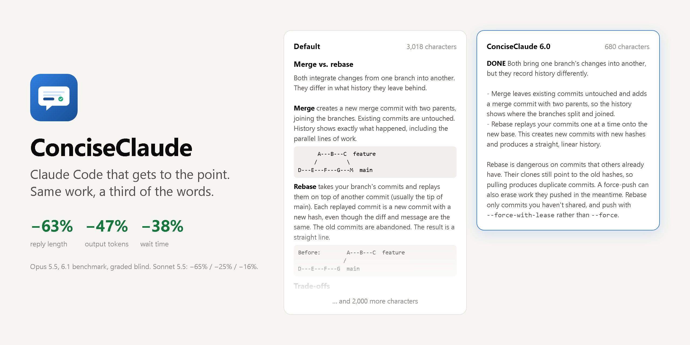
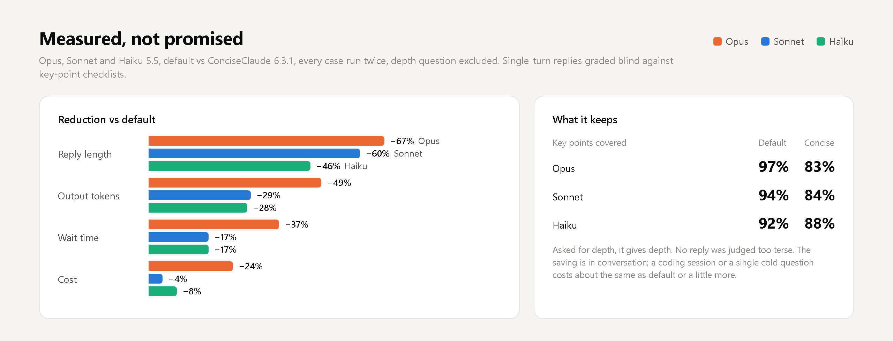
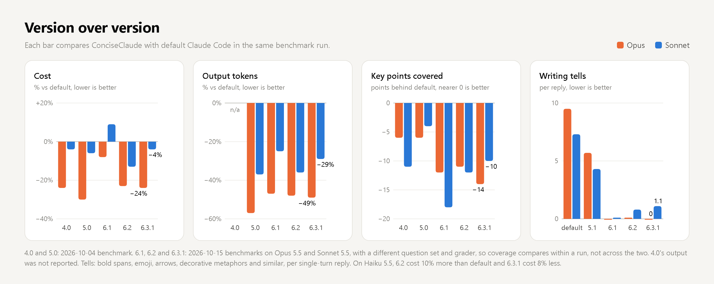

<p align="center">
  
</p>

<h1 align="center">ConciseClaude</h1>

<p align="center"><b>Claude Code that gets to the point. Same work, a third of the words.</b></p>

<p align="center">
  <a href="docs/bench-2026-10-15-v6.md"></a>
  <a href="CHANGELOG.md"></a>
  
  <a href="LICENSE"></a>
</p>

<picture>
  <source media="(prefers-color-scheme: dark)" srcset="assets/hero-dark.png">
  
</picture>

ConciseClaude is a Claude Code plugin that changes how much Claude says and
how it says it. It leaves alone how much Claude reads, thinks and checks.
Replies open with the answer in plain sentences, without the preamble,
step-by-step narration and closing recap. Version 6 also targets the habits
readers complain about in Claude's writing: dense coined jargon, decorative
metaphors such as "load-bearing", "it's not X, it's Y" framing, staged
reveals, emoji, and completion claims nobody checked. When you ask for depth
you get it, and errors, risks and safety steps are never trimmed. Code comes
without commentary, and a meter measures every reply so the rules don't
drift.

In the 6.3.1 benchmark ([write-up](docs/bench-2026-10-15-v6.md)), replies
were 67% shorter on Opus 5.5, 60% on Sonnet 5.5 and 46% on Haiku 5.5. Cost
fell 24%, 4% and 8%. The saving is in conversation; a coding session or a
single cold question costs about the same as default or a little more.
Blind graders found 83 to 88% of the key points a full answer covers,
against 92 to 97% for the default, with no reply judged too terse.
A Stop hook scores every reply and nudges Claude when one runs long;
`/conciseclaude:meter report` shows how it's doing.

<picture>
  <source media="(prefers-color-scheme: dark)" srcset="assets/results-dark.png">
  
</picture>

## Install
```
claude plugin marketplace add drknowhow/ConciseClaude
claude plugin install conciseclaude@conciseclaude
```
Start a new session. The Concise style is on in every session while the plugin
is enabled, even if you've chosen another output style. To turn it off, run
`claude plugin disable conciseclaude@conciseclaude`. The hooks need Python 3.8+
(`py -3`, `python3` or `python`) and `sh`, which Claude Code on Windows gets
from Git Bash. Without Python the rules still apply; replies just aren't
measured.

The rules apply to Opus, Sonnet and Haiku. Haiku saves the least: most of
its output is hidden thinking, which the style doesn't shorten.

To upgrade, run `claude plugin update conciseclaude@conciseclaude` and
restart. To measure commits too, run `/conciseclaude:diff-hooks` in each repo
you want measured.

If your organization blocks plugins or marketplaces, use the manual install:
clone this repo, open Claude Code in it, and say "Read IMPLEMENT.md and
implement it." A manual install doesn't force the style; it sets
`outputStyle` in your settings instead. To move from a manual install to the
plugin, follow the last section of [IMPLEMENT.md](IMPLEMENT.md#moving-to-the-plugin).

## What's in it
| Part | File | Job |
|---|---|---|
| Rules | `output-styles/concise.md` | The only copy of the reply rules: budget, reply grammar, plain-writing rules, cut list, never-cut list. Loads into the system prompt. |
| Code rules | `rules/code.md`, `hooks/code_rules.py` | Rules for comments, tests, commits, PR descriptions, tickets and docs. A PostToolUse hook adds them on a session's first file edit (`Edit`, `Write` or C3's `c3_edit`), so chat-only sessions don't pay for them. |
| Session hook | `hooks/session_start.sh` | Keeps the diff meter's copy current at session start. `claude-md-snippet.md` points manual installs at the rules from CLAUDE.md. |
| Meter | `hooks/reply_shape.py` | Stop hook measures each final reply and counts writing tells (decorative metaphor, contrast framing, emoji and others; logged, never nudged). Prompt hook tells Claude when the previous one ran long. `hooks/run.sh` finds the Python to run it; `/conciseclaude:meter` reports. |
| Diff meter | `hooks/diff_shape.py` | Git `pre-commit` and `commit-msg` hooks, installed per repo by `/conciseclaude:diff-hooks`. Flags swallowed exceptions, dividers, forensic comments, comment blocks of six or more lines, docstrings longer than their body, comment-heavy diffs, oversized commits, and long or headed commit bodies. |
| One-turn stages | `commands/v.md`, `commands/u.md` | `/conciseclaude:v <ask>` lifts the budget for one reply. `/conciseclaude:u <ask>` squeezes it to 150 chars. |
| Plugin | `.claude-plugin/`, `hooks/hooks.json` | Manifest, one-plugin marketplace, and hook wiring. |
| Visuals | `assets/`, `docs/index.html`, `docs/benchmark/` | Icon and README images (HTML sources in `assets/src/`), and the GitHub Pages site with the 5.0 interactive benchmark. |
| Writing pass | `skills/human-prose/SKILL.md` | For prose other people read: PR descriptions, docs, tickets, email. |
| Version | `VERSION`, `CHANGELOG.md` | One canonical version; `tests/test_version_sync.py` fails if any copy drifts. |
| Benchmark | `bench/ab.py` | Token, cost and speed A/B of style on vs off, using headless Claude Code. Not installed. |
| Tests | `tests/` | `python -m pytest tests`, or run any `tests/test_*.py` file directly. |

## What a reply looks like
```
**DONE** Token expiry was comparing local time with UTC; it now uses UTC.
auth/middleware.py:42 calls datetime.now(timezone.utc). The 118 unit tests
pass; I didn't run the browser tests.
**Need you:** ship to staging now, or wait for the Monday window?
```
The result comes first, after a plain-word tag (DONE, CAVEAT, BLOCKED or
WORKING). Detail follows only if it changes your next move, in complete
sentences. Literals are verbatim. **Need you:** comes last, and only when
Claude is blocked on you. A compact reply gets 600 prose characters.
Security, destructive commands, errors, and plans get 900, but only under a
visible label like **Risk:** or **Plan:**.

## Plain writing
Version 6.0 adds rules against the writing habits readers flag in Claude's
output. They come from four research passes and 45 days of transcripts
([write-up](docs/claude-slop-research-2026-10-15.md)). On current models
most of these habits are in how sentences are built, and few are about
vocabulary:
- text compressed until it needs a second read, with labels nobody defined;
- metaphors in place of plain words ("load-bearing", "seam", "earns its
  keep");
- "it's not X, it's Y" framing, and rebuttals of points nobody made;
- a point held back for the last line, "this matters", "honestly";
- bold on every bullet, emoji and status symbols;
- "production-ready" or "fully verified" when one test suite ran.

The rules name each pattern and give the replacement: cut points instead of
words, use the literal word, say what was checked and what wasn't. The
`human-prose` skill applies the same list to PR descriptions, docs and
email. The meter counts the patterns in every reply and `report` shows the
rates. In the 6.3.1 benchmark they fell from 7 to 9 per reply on the
default style to none on Opus, one on Sonnet and two on Haiku.

## What code and repo text look like
The same rule set covers what Claude writes for other people to maintain
and review. Comments default to none; one that exists states, in a line or
two, what the code can't show. Dates, incidents and measurements go in the
commit body, which gets eight lines. Docstrings are contracts, not
histories. Test names say the behaviour. A PR description is two to five
sentences: the problem, the cause, the new behaviour, the rollout risk and
what ran. A ticket gives steps to reproduce or acceptance criteria. Guards
sit at real boundaries and never swallow, and nothing ships with zero
non-test callers.

```
python ~/.claude/hooks/diff_shape.py scan             # what the meter says about the current tree, before installing
python ~/.claude/hooks/diff_shape.py install          # in each repo: writes .git/hooks/pre-commit and commit-msg
python ~/.claude/hooks/diff_shape.py report --days 7  # commits measured, median comment share, findings by code
python ~/.claude/hooks/diff_shape.py mode block       # off | warn (default) | block on fail-class findings
```

## Why it's built this way
Each choice comes from running an earlier version of this system.

There is one copy of the rules. The earlier setup had three overlapping
limits (four lines, five lines, 400 characters), and replies drifted toward
the loosest.

The budget counts characters, not lines, because lines wrap differently in a
terminal, an IDE panel and a phone. Prose outside code and URLs tracks what
you read. Table cells count too, since moving text into a table doesn't make
it shorter to read.

The budget leaves room for whole sentences. Under the old 400-character
budget, IDE replies had a median of 532 to 648 characters, and the squeezed
text was hard to read: a model asked only for brevity drops articles and
coins shorthand. 6.0 raised the budget to 600 and added rules that keep
sentences whole.

Exceptions are bounded and labeled. An open-ended list of things never to
compress (security, errors, planning, review) covered most real work, so
most replies qualified. The exception now has a 900-character ceiling and
needs a visible label.

The meter measures at the output, because a rule nobody measures can't be
tuned. It never truncates, since mechanical cutting would remove exactly the
error text you needed. By default it nudges rather than blocks: in block
mode Claude rewrites, but the rewrite lands under the long reply, so you
read both.

Code rules target content, not length. An audit of thirty Claude-authored
commits (`docs/code-verbosity-audit-2026-09-20.md`) found 15–28% of added
lines removable in three of four repos, almost all comments and docstrings,
and eleven robustness defects under the prose. Length caps get gamed into
denser code, so the diff meter fails on the defect signals (swallowed
exceptions, forensic comments, dividers) and only warns on ratios.

## Evidence
<picture>
  <source media="(prefers-color-scheme: dark)" srcset="assets/versions-dark.png">
  
</picture>

Each release against the default style. 4.0 and 5.0 come from the
2026-10-04 benchmark ([interactive page](https://drknowhow.github.io/ConciseClaude/benchmark/)),
6.1 to 6.3.1 from the 2026-10-15 runs ([write-up](docs/bench-2026-10-15-v6.md)),
which used a different question set and grader, so compare coverage within
a run rather than across the two. 6.1 cut the writing tells to near zero but
cost more than 5.0, mostly from longer rule text; 6.2 halved that text and
won most of the cost back. Sonnet's saving varies most between runs: 13% for
6.2 and 4% for 6.3.1, with the same rules apart from one line about Haiku.
Coverage is the open gap: 6.3.1 covers 83% of key points on Opus and 84% on
Sonnet, against 97% and 94% for the default. Haiku isn't plotted; there 6.2
cost 10% more than the default and 6.3.1 8% less.

An earlier controlled A/B on Sonnet ([write-up](docs/token-ab-2026-10-03.md))
found the same shape in six-turn conversations: output tokens fell 28% and
cost 9%, with the saving in conversation and a wash in coding, where tool
calls and file contents make up most of the output. Reproduce it with
`python bench/ab.py`.

## Operating it
```
/conciseclaude:meter report --days 7        # median, p90, % over, asked_more, asked_shorter, writing-tell rates
/conciseclaude:meter mode block             # off | nudge (default) | block
/conciseclaude:meter diff report --days 7   # the diff meter's report
```
A manual install runs the same thing as `python ~/.claude/hooks/reply_shape.py report --days 7`.

Budgets live in the `BUDGETS` dict at the top of `reply_shape.py`, and the
rules in `output-styles/concise.md` only. The plugin's copy is replaced on
every update, so change the rules in a fork or a PR here, not in the plugin
cache.

The report's `asked_more` and `asked_shorter` columns count replies followed
by `/v` or `/u`. If `asked_more` climbs while the median falls, the budget
is cutting substance. Only the explicit commands count, so if you never
type them the columns stay at 0%.

`mode off` stops all feedback but keeps measuring. Removing the hook entries
stops measuring too.

## What it runs, stores and sends
Everything runs on your machine. ConciseClaude makes no network requests and
sends no telemetry.

The hooks in `hooks/hooks.json` each run through `hooks/run.sh`, which
starts the first Python 3.8+ it finds. At session start, `session_start.sh`
refreshes the diff meter's copy. When a reply finishes, `reply_shape.py`
measures it, and when you send the next prompt it tells Claude if that reply
ran long. After the first file edit in a session, `code_rules.py` adds the
code rules.

`~/.claude/reply_shape/` holds the reply log (sizes, flags, writing-tell
counts and a 12-character hash per reply, never the reply text), the mode
setting and small per-session markers. If you install the diff meter, it
also uses `~/.claude/diff_shape/` (counts only, never code) and a copy of
its script in `~/.claude/conciseclaude/`.

Nothing is written outside those folders unless you run
`/conciseclaude:diff-hooks` in a repo, which writes `.git/hooks/pre-commit`
and `.git/hooks/commit-msg` there and won't overwrite a hook it didn't
write. The plugin doesn't change your settings: it forces its output style
while enabled, and disabling the plugin removes it.
